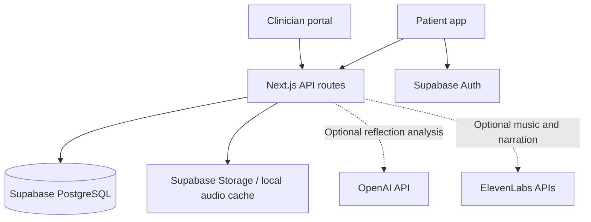

# OtaPath — Project Description

**A walking companion that connects everyday exploration, personal memories, and clinician follow-up after TMS treatment.**

## Overview

OtaPath is a browser-based recovery companion designed for people rebuilding
their daily routines after transcranial magnetic stimulation (TMS) treatment.
It combines short walking missions, a personal map, photo and voice journaling,
and personalized audio with a dashboard for the care team.

The patient experience centers on small, achievable activities: visit a nearby
place, notice a detail, take a photo, and record a short reflection. These moments
become memories on the map and provide signals that the clinician can review.

The project was built during a hackathon in Otaniemi, Finland. Its name combines
**Otaniemi** with the idea of a personal **path** back into everyday life.

## The Problem

OtaPath focuses on the period between clinical treatment and everyday life at
home. The project addresses three practical challenges:

- **Getting started:** a large activity goal can feel difficult when energy and
  motivation are low. A short, concrete task offers a more manageable starting
  point.
- **Keeping a useful record:** repeated questionnaires can feel disconnected
  from a person's day. Photos and voice notes give journaling a personal purpose.
- **Maintaining continuity:** clinicians need a concise view of changes between
  appointments and a way to suggest an appropriate next activity.

The design question is: **how can a small, meaningful daily activity also support
an ongoing conversation between a patient and their care team?**

## Project Goal

The goal is to make recovery support easier to engage with in daily life while
giving clinicians a more connected view of the patient's activity and reflections.

OtaPath aims to encourage gradual exploration, sensory attention, and personal
recall. Its tone is supportive: the interface offers gentle tasks, comfort
options, and a friendly dog companion without streak penalties.

## The Solution

OtaPath connects the patient app and clinician portal through a shared workflow:

1. **Set up a patient profile.** The clinician creates an account and can adjust
   mission difficulty, music preferences, and audio settings.
2. **Choose a manageable mission.** The app suggests a nearby destination and
   a simple observation task, taking the current energy state into account.
3. **Explore the neighborhood.** Walking reveals the map and creates a visible
   record of places explored.
4. **Capture a moment.** The patient saves a photo, a short voice note, and a
   reflection as a location-based memory capsule.
5. **Review the signals.** The app extracts acoustic and image features, analyzes
   the reflection, and updates the stored record and clinician view.
6. **Continue the conversation.** The clinician can review the activity, send a
   supportive check-in, or assign a custom mission. The patient can later revisit
   an older memory through the Memory Echo feature.

## Main Features

### Exploration Map and Local Missions

The patient app uses a map with a fog-of-exploration effect. Nearby destinations
include nature spots, cultural places, and opportunities for physical activity.
OpenStreetMap data is queried through Overpass, while walking routes use OSRM.
Procedural nearby destinations and direct route fallbacks keep the experience
usable when those services cannot respond.

### Memory Capsules

Each capsule can combine a location, photo, recorded voice note, transcript,
analysis results, and a personalized soundtrack. The map becomes a personal
collection of moments. Memory Echo invites the patient to recall a concrete
detail from an older capsule and revisit the original recording.

### Voice, Image, and Reflection Analysis

The browser processes microphone audio to estimate features such as vocal energy,
pitch variation, speech-to-pause ratio, and initiation latency. Image analysis
measures brightness and color vibrancy. Transcript analysis identifies sensory
detail, themes, and emotional tone, and can produce a soundscape prompt.

The transcript endpoint supports an optional OpenAI integration and a local
heuristic fallback. These scores are prototype signals for the application,
with clinical interpretation and validation remaining future work.

### Personalized Audio and Comfort Mode

Patients can choose musical styles such as piano, acoustic, lo-fi, and nature
soundscapes. ElevenLabs integrations provide generated music, sound effects,
and spoken narration when configured. An on-device Web Audio synthesizer
provides an alternative when generated audio is unavailable.

The audio engine also implements stereo binaural tones and rhythmic modulation,
including a manually configurable Individual Alpha Frequency (IAF) parameter.
Comfort Mode provides an indoor sensory experience for days when a walk is
not appropriate.

### Clinician Dashboard

The clinician portal includes a patient cohort overview, individual trend charts,
memory review, mission assignment, and supportive messages. A rule-based triage
function summarizes recent changes using three prototype statuses: **Stable**,
**Drift**, and **Intervention**. Context flags such as illness or being housebound
can adjust how mobility contributes to the summary.

### Experimental Personalization

A lightweight contextual bandit records outcomes and ranks activity and audio
options using reward scores. The implementation combines seeded demonstration
history with application interactions to illustrate an adaptive feedback loop.
Its recommendations and displayed improvements require further evaluation.

## Technology Stack

| Area | Technologies | Role |
| --- | --- | --- |
| Web application | Next.js 16, React 19, TypeScript | Patient interface, clinician portal, and server API routes |
| Styling | Tailwind CSS 4, Lucide React | Responsive layouts, visual system, and icons |
| Client state | Zustand, localStorage | Application state, preferences, and local demo snapshots |
| Maps and routing | Leaflet, React Leaflet, OpenStreetMap, Overpass, OSRM | Exploration, nearby destinations, and walking routes |
| Audio and capture | Web Audio API, MediaRecorder, browser speech recognition | Recording, acoustic feature extraction, synthesis, and supported transcription |
| Image processing | Browser Canvas API | Photo luminance and color analysis |
| Backend and identity | Supabase PostgreSQL, Supabase Auth, Supabase JavaScript client | Persistent records and patient sign-in |
| Generated audio storage | Supabase Storage, local filesystem fallback | Caching and serving generated soundtracks |
| Optional AI services | OpenAI API, ElevenLabs APIs | Reflection analysis, music, sound effects, and narration |
| Demo video | Remotion, React, Playwright, FFmpeg, Python, Kokoro, Whisper | Video composition, app recording, audio generation, and alignment |

## Architecture and Data Flow

The patient app and clinician portal belong to the same Next.js application.
Acoustic and image features are computed in the browser. API route handlers
store records and call optional AI services on the server.

Database access uses a server-only Supabase client. The schema enables Row Level
Security and blocks direct clinical-table access for browser roles; the API uses
a privileged service-role key. Because that key bypasses RLS, authorization at
the API layer is essential for a production deployment. See the
[Supabase API key documentation](https://supabase.com/docs/guides/getting-started/api-keys)
for the distinction between client and server keys.

The data model includes patients, memory capsules, missions, clinician messages,
daily signal summaries, and bandit rewards. API polling synchronizes records
across devices. BroadcastChannel and localStorage support immediate communication
between tabs and embedded demo views in the same browser.

## Repository Contents

| Location | Contents |
| --- | --- |
| `OtaPath/` | Next.js application and its dependencies |
| `OtaPath/src/app/` | Landing page, patient routes, clinician portal, demo, and API endpoints |
| `OtaPath/src/components/` | Map, journaling, audio, clinician, and interface components |
| `OtaPath/src/lib/` | Signal processing, routing, persistence, triage, and personalization logic |
| `OtaPath/src/store/` | Shared patient application state |
| `OtaPath/supabase/schema.sql` | Database schema and seeded demonstration accounts and records |
| `otapath-video/` | Editable two-minute pitch video, recordings, narration, music, and capture scripts |

The main application entry points are `/app` for patients, `/clinician` for the
care team, and `/demo` for a presentation view. The repository root
[README](README.md) contains the basic application and video commands.

## Current Status and Next Steps

OtaPath is a hackathon prototype with working capture, signal-processing, map,
audio, persistence, and clinician interaction flows. The demo also uses fictional
patients, seeded histories, and simulated values, including HRV and sleep data.
The repository does not provide a live wearable or EEG integration.

Further development would focus on evaluating the experience with patients and
clinicians, validating the signal summaries, strengthening endpoint authorization
and data handling, integrating consent-based wearable data, and testing whether
personalization improves sustained engagement. The audio features and triage
labels demonstrate the product concept; clinical effectiveness is not established
by this implementation.
